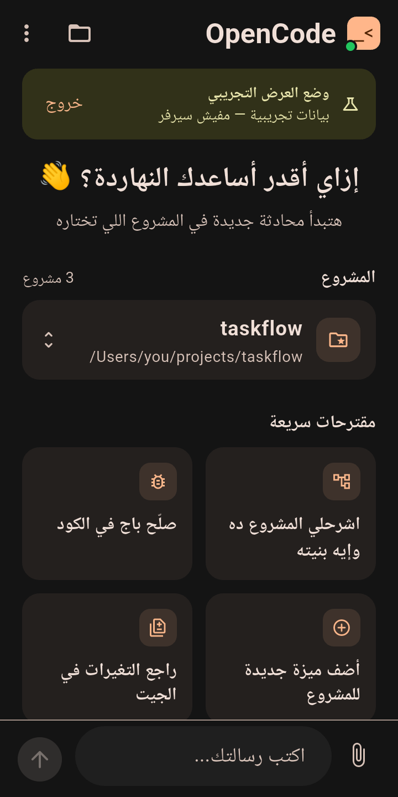
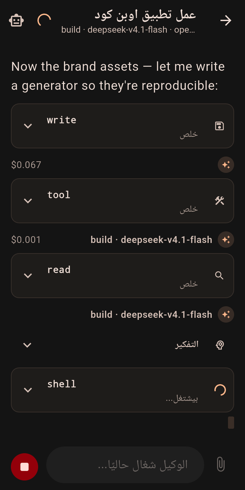
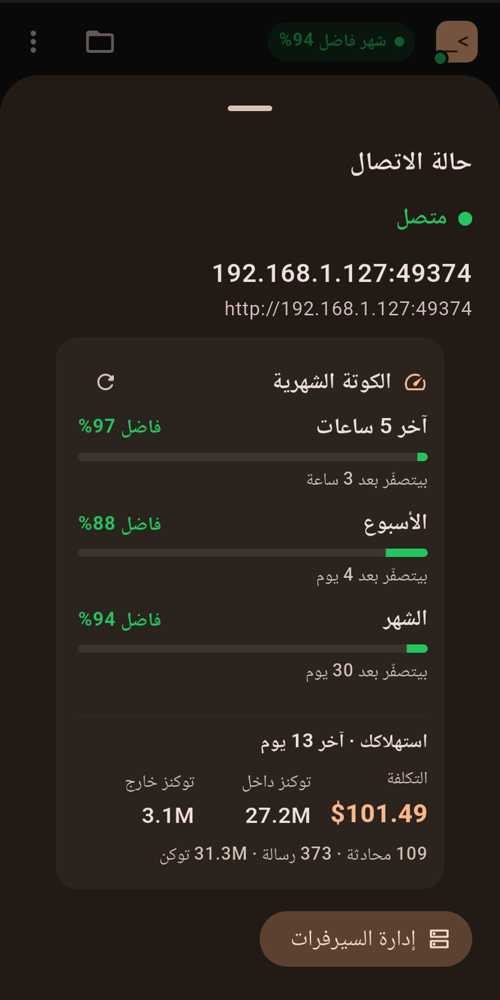
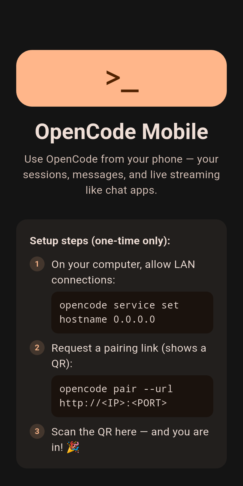

# OpenCode Mobile

**An unofficial mobile client for [OpenCode](https://opencode.ai)** — chat with the coding
agent running on your own computer, from your phone.

Pair once with a QR code, then follow your sessions live: replies stream in word by word,
reasoning folds away, every tool call shows up as a card, and permission requests are
approved right from your pocket.

> [!NOTE]
> This is an **unofficial, community-built** client. It is **not** built by, endorsed by, or
> affiliated with the OpenCode team. OpenCode itself is open source (MIT) at
> [github.com/anomalyco/opencode](https://github.com/anomalyco/opencode).

<p align="center">
  
</p>

---

## How it works

```
┌──────────────┐     QR pairing (one time)     ┌─────────────────────┐
│    Phone     │ ────────────────────────────► │  Your computer      │
│  this app    │                               │  OpenCode (server)  │
│   Flutter    │ ◄──────── SSE (live) ──────── │  sessions + models  │
└──────────────┘   HTTP API (prompts/actions)  └─────────────────────┘
```

OpenCode V2 is client–server: a background server owns the sessions, messages and
permissions, and exposes an **HTTP API** plus an **SSE** stream for live events.
This app is a client for it. It does **not** run models on the phone — it drives the
server on your machine, so you get the full power of your own agent in your hand.

## Features

**Core**
- ✅ **QR pairing** — scan the code from `opencode pair`, no accounts, no sign-up
- ✅ **Session list** — every session with its title, cost and model
- ✅ **Live streaming** — text appears as it is written, reasoning is collapsible
- ✅ **Tool cards** — read/edit/shell/browser… with input and output
- ✅ **Permissions** — approve or reject from the phone (once / always / reject)
- ✅ **Interrupt** — stop a running agent
- ✅ **New sessions** — pick a project and start chatting
- ✅ **Auto-reconnect** — reconnects and reconciles with the server after any drop

**More**
- ✅ **Multi-server** — manage several OpenCode servers, switch with one tap, each with
  its own pairing
- ✅ **Plan quota meter** — how much of your OpenCode Go allowance is left (5-hour,
  weekly and monthly windows, with reset countdowns)
- ✅ **Spend overview** — cost and tokens for the period, straight from the server
- ✅ **Background notifications (Android)** — get told when the agent is waiting for a
  permission decision or when a run finishes. iOS: not yet (needs server-side push, see
  the roadmap)
- ✅ **Arabic & English** — full RTL UI, light/dark/system theme

**🧪 Demo mode — no server needed**
Want to see it without installing OpenCode? On the pairing screen tap
**“Try it without a server — demo mode”**: sample projects, conversations, a streamed
reply, a tool card and a pending permission request. (This is also how store reviewers
can try the app — see [`docs/PLAY_STORE.md`](docs/PLAY_STORE.md).)

## Screenshots

| Home (quota chip) | Live run with tool cards | Quota & spend | Pairing |
|---|---|---|---|
|  |  |  |  |

## Install

### Requirements on the computer
- OpenCode v2.x installed (`curl -fsSL https://opencode.ai/install | bash`)
- Phone and computer on the **same network**, or [Tailscale](https://tailscale.com) to
  connect from anywhere

### One-time pairing

On the computer:

```bash
# 1) let the OpenCode server accept connections from the network
opencode service set hostname 0.0.0.0

# 2) request a pairing link (prints a QR + a URL)
opencode pair --url http://<COMPUTER-LAN-IP>:<PORT>
```

> 💡 Find your IP with `ipconfig getifaddr en0` (macOS); the port is on the last line
> printed by `opencode pair` (e.g. `49374`).

On the phone:

1. Install the app (see below).
2. Tap **“Scan the QR code”** and scan what the terminal printed — or paste the link.
3. That's it 🎉 — your sessions are there and you can start a new chat.

> If the server is updated or changes port after a restart, the old pairing stops
> working — just pair again. Your sessions live on the server and are unaffected.

### Build from source

```bash
flutter pub get
flutter test

# Android
flutter build apk --release        # build/app/outputs/flutter-apk/app-release.apk

# iOS (needs macOS + Xcode)
flutter build ipa --release
```

Supported: **Android** and **iOS** (macOS works too for local testing:
`flutter run -d macos` — paste the pairing link instead of scanning).

## Project layout

```
lib/
├── app.dart                        # MaterialApp, theme, brand mark, root routing
├── core/
│   ├── models.dart                 # API models (sessions/messages/parts/events)
│   ├── opencode_client.dart        # REST + SSE client (basic auth + reconnect)
│   ├── connection_store.dart       # secure storage for the paired servers
│   ├── quota.dart                  # plan quota (OpenCode Go usage API)
│   ├── usage.dart                  # local spend (cost + tokens)
│   ├── demo_client.dart            # demo mode: a complete in-memory server
│   ├── watcher_config.dart         # background watcher settings
│   ├── notification_watcher.dart   # background isolate TaskHandler (SSE + poll)
│   └── notification_center.dart    # main isolate: init + local notifications
├── state/                          # app / sessions / chat / quota / settings
├── screens/                        # welcome, scanner, home, chat, projects, settings
└── widgets/                        # bubbles, tool cards, permissions, quota, composer

tools/                              # brand asset generator, keystore + screenshot scripts
store/                              # store icon, feature graphic, screenshots
docs/                               # Play & App Store checklists, store copy, privacy
```

## Technical notes

- **Auth** — the OpenCode server uses HTTP Basic (`opencode:<token>`). The token comes
  from the one-time pairing link and is stored with `flutter_secure_storage`
  (Keychain on iOS/macOS, Keystore on Android), with an app-private file fallback.
- **Events** — `GET /api/event` (SSE) is live-only (no replay), so the app reconnects
  automatically and refreshes state from the server afterwards.
- **Background notifications** depend on two things that must stay in the project:
  1. the `<service>` declaration for `flutter_foreground_task` in
     `android/app/src/main/AndroidManifest.xml` — the plugin does not ship it, and from
     Android 14 on it must carry `foregroundServiceType`;
  2. `FlutterForegroundTask.initCommunicationPort()` in `main()` — without it nothing
     sent by the service isolate ever reaches the UI.
  `test/android_notifications_test.dart` guards both.
- **Permissions** are polled (`GET /api/session/{id}/permission`) every 2.5s while the
  agent runs, plus immediately after each tool call; replies go to
  `POST /api/session/{id}/permission/{requestId}/reply`.
- **Quota** is not exposed by the server API. The server *does* hold the account
  credential, so the app asks it (`GET /api/credential`) and reads OpenCode's own
  accounting at `https://opencode.ai/zen/go/v1/usage`.
- All shapes in `models.dart` are based on real responses from an OpenCode 2.0.x server
  (see `test/models_test.dart`).
- **Plain HTTP** is allowed on the local network only, because that is how the OpenCode
  server talks. Use Tailscale (encrypted) if you connect over the internet.

## Publishing

- Package name: `com.gws.opencode`
- Icons and store artwork are generated by `python3 tools/generate_brand_assets.py`
- Google Play: [`docs/PLAY_STORE.md`](docs/PLAY_STORE.md) ·
  [`docs/store-listing.md`](docs/store-listing.md) (copy ready to paste) ·
  [privacy policy](https://globalwebsolutions.github.io/opencode-mobile/privacy/)
- App Store: [`docs/APP_STORE.md`](docs/APP_STORE.md)

## Related projects

| Project | Description |
|---|---|
| [**OpenCode Chat Sidebar**](https://github.com/globalwebsolutions/opencode-chat-sidebar/releases) | VS Code extension — chat with OpenCode agents inside your editor (same team) |

> Both talk to the same OpenCode server, so you can start a conversation on the desktop
> and pick it up from the phone (or the other way round).

## Roadmap

- Model/agent picker from inside the app
- Diffs and changed files inside tool cards
- Search across sessions
- Live terminal over WebSocket PTY (`/api/pty`)
- iOS background notifications (needs server-side push)

## Credits

Built and maintained by **Global Web Solutions** — 2026.
🔗 [Globalweb.Solutions](https://Globalweb.Solutions)

## License

MIT — the same license as OpenCode.

---

<details>
<summary><b>بالعربي (ملخص سريع)</b></summary>

تطبيق موبايل **غير رسمي** لسيرفر OpenCode اللي على جهازك: تتابع محادثاتك والردود
بتتكتب لحظيًا، كروت الأدوات، وموافقة الصلاحيات — كله من التليفون.

**التوصيل مرة واحدة:**
```bash
opencode service set hostname 0.0.0.0
opencode pair --url http://<IP-الكمبيوتر>:<PORT>
```
بعدين من التطبيق: **امسح كود الـ QR** وخلاص.

- مفيش حسابات ولا جمع بيانات — التفاصيل في
  [سياسة الخصوصية](https://globalwebsolutions.github.io/opencode-mobile/privacy/).
- عايز تجرّب من غير سيرفر؟ شاشة التوصيل ← **«جرّب من غير سيرفر — وضع العرض»**.
- خطوات النشر: [`docs/PLAY_STORE.md`](docs/PLAY_STORE.md).

</details>
